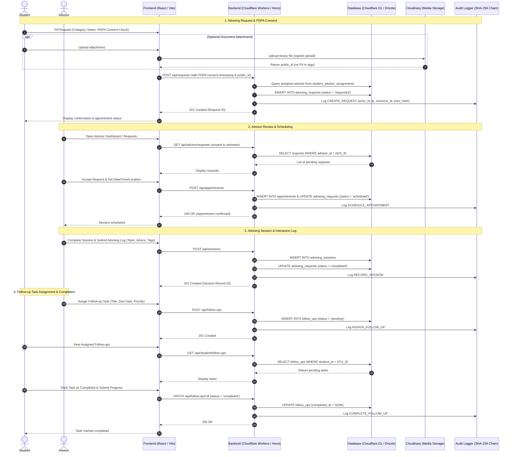

# AdvisingLog — Sequence Diagram

This document illustrates the end-to-end advising session lifecycle across actors and system components, matching the locked Alpha Demo workflow in [`CLAUDE.md`](../../CLAUDE.md) and [`spec.md`](../01-requirements/spec.md).

## Workflow Summary

1. **PDPA Consent & Scoping:** The request requires explicit consent recording before submission.
2. **Auto-routing:** The backend validates and routes requests based on the pre-configured `student_advisor_assignments` table.
3. **Cloudinary Asset Storage:** Only the `public_id` is persisted in Cloudflare D1; binary files never touch the SQLite database.
4. **Audit Logging (Computer Crime Act §26):** Every state transition triggers an append-only audit log entry with SHA-256 hash chaining to ensure tamper evidence.
